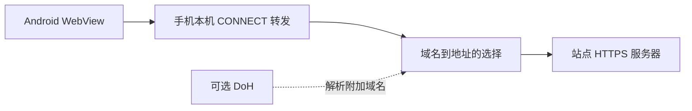

# TaiAV Android

Kotlin 原生 Android 浏览应用，复用 `https://taiav.com/cn` 的网页。最低 Android 8.0，目标 Android 16。

## 安装

在 [GitHub Releases](https://github.com/jiqinga/TaiAV-Android/releases/latest) 下载签名安装包 `TaiAV-0.0.1.apk`。公开版本从 **0.0.1** 开始，支持 Android 8.0 及以上。

首次从此前本地 Debug 版切换至 Release 版，需要先卸载旧版；卸载前可通过应用备份入口导出收藏和规则。后续 Release 采用相同签名，递增版本后支持覆盖更新。

连接并授权 Android 真机后，先核对序列号再安装：

```powershell
adb devices -l
adb -s DEVICE_SERIAL install -r .\TaiAV-0.0.1.apk
```

## 已实现

- WebView 页面浏览、站内导航、登录 Cookie、加载进度和错误重试。
- 原生深色界面，首页、收藏、历史、设置四个入口。
- 收藏、长按移除收藏、最多 100 条浏览历史、清空历史。
- 网页播放器全屏、横屏及返回恢复；退出到后台时暂停主文档媒体。
- 原生 Media3 ExoPlayer 与 mpv 双引擎：进度拖动、±10 秒、0.5–2 倍速、横竖屏、控制栏自动收起、后台暂停和引擎间进度衔接。
- 播放缓冲条与剩余缓冲时间；Media3 多画质自动/手动选择，mpv 按 HLS 主列表选择码率。
- 本站备用 IP 直连、可编辑备用地址、系统网络模式。
- 可选 DoH：`linuxdo`、`plus` 或自定义 HTTPS 地址。
- 应用内 HTTPS 连接诊断：状态码、TLS 版本、连接耗时及地址。
- 清理网页缓存，保留收藏、历史和 Cookie。
- 默认开启广告过滤：在资源请求发出前拦截广告域名、子域名和本站已确认的广告脚本路径。
- 阻止广告弹窗，隐藏横幅和动态插入的广告容器；普通站内新窗口链接在当前页打开。
- 设置中支持关闭过滤、自定义拦截域名和放行域名；保存后自动重载网页。
- 广告拦截日志：域名、资源类型、来源、最近时间和聚合次数；支持一键放行并重载、长按复制域名。
- 继续观看：每 5 秒以及暂停、拖动、结束时保存进度；历史页和设置均提供入口。
- 收藏与规则备份：通过系统文件选择器导出 JSON，导入前显示条目摘要，支持合并或替换。
- 网络故障定位：首页、最近图片与视频资源分别探测，显示 HTTP / TLS / 地址 / 耗时，并保留网页实际失败的域名及分类。

## 播放控制布局

Media3 与 mpv 共用播放器布局：播放 / 暂停位于画面中央，快退 10 秒与快进 10 秒位于左右两侧；进度条在底部，时间在左下，倍速、画质和全屏在右下；顶部提供返回、标题、引擎切换、下载与网页入口。上下区域采用渐变遮罩，中央按钮有半透明圆形底，点击画面同步显示 / 隐藏所有控制，播放时自动收起，暂停时显示。全屏切换为横屏，退出全屏回到竖屏。按钮有中文无障碍说明与长按提示；中央播放按钮 72dp，两侧 56dp，辅助按钮至少 48dp。

## 原生播放与离线缓存

在视频页面点击顶部播放图标，选择 **Media3 ExoPlayer / mpv / 网页播放器**，再点击「播放」。设置 → 默认播放器会记住选择；原生播放器顶部可切换引擎和返回网页。页面仍由网站提供，原生播放由用户主动触发。

媒体源从当前页面的网络请求和主播放器中识别，支持 HTTPS 的 HLS（`.m3u8`）、DASH（`.mpd`）及 MP4 / WebM / MKV 地址；媒体分片和 `blob:` 地址不会直接传入原生播放器。若尚未识别媒体源，先点击网页播放器使其加载，再点击顶部播放图标。多个候选源会显示选择列表；预览源、不同清晰度和跨域 iframe 的来源判断仍需结合实际站点确认。

Media3 及 mpv 的缓存读取器使用 WebView 的 User-Agent、已识别请求的 Referer、按请求域名获取的 Cookie，并将响应 Cookie 写回。mpv 直接播放 DASH 时使用系统证书生成的临时 PEM 信任库与仅限媒体源主机的 Cookie 文件，此路径的新 Cookie 暂未写回 WebView。两种引擎均使用会话独立的本机 CONNECT 转发，沿用备用 IP / DoH 和域名过滤规则，保留 TLS 校验。需要额外请求签名、专有脚本或 DRM 的媒体仍可在网页入口尝试。

原生进度写入现有「继续观看」，每 5 秒及暂停、切换、离开时保存；返回后同步主文档网页播放器的位置，保持暂停。原生播放进入后台会暂停并释放解码器，回到前台点击播放继续。耳机断开或音频焦点被其他应用占用时暂停。

播放中点击画面显示控制栏：「画质」列出媒体源实际提供的档位。Media3 支持 HLS / DASH 中的多画质自动调整或手动锁定；mpv 从 HLS 主列表读取分辨率与码率，选择后重新连接原始主列表并恢复当前位置，保留独立音轨信息。单档媒体显示原始画质。mpv 的 DASH 或其他格式暂按原始画质播放；不同 URL 的线路可返回网页重新选择媒体源。

设置 → 预加载缓冲可选 15 / 30 / 60 / 120 秒（默认 60 秒），应用于下一次打开的原生播放会话。Media3 初次启动目标 1.5 秒、卡顿恢复目标 3 秒；mpv 的内存解复用缓存上限 64 MiB。进度条浅色部分显示已缓冲范围，状态行显示当前位置之后的缓冲时间。实际缓冲量受网络、码率与内存策略影响，不保证达到目标，也不预下载下一集。

设置 → 播放缓存容量可选 64 / 256 / 512 / 1024 MB（默认 256 MB），按最近使用自动清理；「清理播放缓存」只清理这部分。Media3 自动缓存媒体数据，mpv 的 HLS / MP4 通过会话独立的本机缓存读取器复用相同磁盘缓存。mpv 的 DASH 暂维持直接网络播放。

播放页 → 离线下载：支持 HLS 点播（带 `EXT-X-ENDLIST`）与 MP4，使用 Media3 `DownloadManager` 和前台下载服务保存完整媒体；HLS 主列表当前会保存全部变体与音轨，下载量可能大于当前播放档位。任务及进度持久保存，设置 → 离线下载可查看速度、预计剩余时间，暂停、继续 / 重试、删除，完成后可选 Media3 或 mpv 离线播放。HLS 的剩余时间根据分片进度估算，分片大小不同会使估算波动。离线数据位于应用私有存储，手动删除或卸载前保留，独立于播放缓存容量上限。下载前至少需 256 MB 可用空间，下载中磁盘不足会进入失败状态，清理后可重试。签名 URL 或登录 Cookie 失效也可能需要回到网页重新加入任务。

设置 → 下载并发数提供 1 / 2 / 3 / 4 / 6 / 8 / 12 / 16 / 24 / 32 路（默认 6 路），限制一个 HLS 下载任务的并行分片数，修改后保存并立即更新下载线程池。调低时已开始的分片先完成，后续按新上限调度；同一时间处理一个视频任务，MP4 仍使用单连接下载。实际速度取决于源站与网络，并发数不代表固定提速比例。

离线播放使用只读缓存源，网络上游置空；mpv 使用仅绑定 `127.0.0.1`、每次会话随机令牌的本机读取器，重写 HLS 变体、音轨、初始化分片、密钥与分片 URL，数据仍由缓存读取。缺失片段会报错，不会自动用网络补齐。下载中可查看进度，完成状态才提供离线播放入口。直播、DRM / SAMPLE-AES 与当前不支持的媒体格式继续使用在线播放；系统停止应用或设备重启后，可在离线列表继续已有任务。

mpv 通过 `dev.jdtech.mpv:libmpv:1.0.0` 接入，Media3 固定为 `1.9.4`。通用 APK 包含四种 ABI 的原生库，包体明显增加。上游源码与许可证入口见 [第三方组件说明](docs/PLAYER_DEPENDENCIES.md)。

## 功能入口

| 功能 | 入口与操作 |
|---|---|
| 拦截日志 | 设置 → 广告拦截日志 → 放行域名并重载 |
| 继续观看 | 历史 → 继续观看，或设置 → 继续观看；打开视频后选择继续或从头播放 |
| 备份 | 收藏页或设置 → 收藏与规则备份 → 导出到文件 / 从文件导入 |
| 故障定位 | 设置 → 检测连接；先浏览图片和尝试播放，才能采集对应资源 |

播放记录最多 100 条，语言不同的同一视频合并为一条。视频播放到最后 5 秒或结束后移除继续观看记录；初次加载时的零进度不会覆盖旧记录。恢复进度后按播放器按钮继续播放，遵循 WebView 的用户手势要求。主文档播放器受支持，跨域 iframe 内的播放器暂未接入进度保存。关闭 App 进程时可能损失最后约 5 秒进度；暂停和常规离开页面会补充保存。

备份仅包含收藏、自定义拦截域名、放行域名和广告过滤开关。导入文件最大 2 MB、最多 1000 条收藏、每组最多 128 个域名；导入前校验全部内容，格式错误或超限时保留原有数据。合并时按收藏 URL 去重，已有收藏标题保留，广告开关采用备份值；替换只作用于收藏与规则。历史、播放进度、登录 Cookie、IP / DoH 设置以及日志不在此备份范围内。

拦截与失败日志只保存在本次启动的内存中，最多 200 组事件，重启后清空；显示的网址去除查询参数和片段。诊断默认检查首页及最近最多两个图片域名、两个视频域名。HEAD 不受支持时使用 `Range: bytes=0-0` 的 GET，读完响应头即关闭连接；Cookie、签名资源和跳转策略可能让探测结果与实际网页不同，应结合下方的实际失败记录判断。探测保留 TLS 域名和证书校验，不跟随重定向。

## Clash 与系统代理

手机上的 Clash / 类似工具若启用 VPN / TUN，并将 TaiAV 纳入接管范围，应用创建的远端连接通常由该 VPN 路由；实际出口还取决于域名 / IP 规则。默认「备用 IP」模式连接本站的固定 IP 时，也需让该流量匹配预期规则。电脑上的代理仅对电脑生效，手机需单独配置。

当前「系统网络」会清除 WebView 的应用代理覆盖，网页跟随 WebView 的系统代理处理；Media3、mpv 与离线下载仍使用应用本机 CONNECT 转发及直接 Socket，尚未自动继承 Wi-Fi / 系统 HTTP 代理。「备用 IP」模式下 WebView 也走应用本机转发。仅开启 Clash 的 HTTP / SOCKS 监听端口与启用 VPN 接管是不同配置。

当前公网地址校验会排除 `198.18.0.0/15`，与部分 Clash Fake-IP DNS 配置存在兼容问题；使用真实 IP DNS 的 VPN 配置更适合当前实现。以上依据连接实现检查，尚未完成手机 Clash 各模式的设备端验证。

## 广告过滤

在「设置 → 广告过滤」开关过滤。「自定义拦截域名」「放行域名」每行填写一个域名，例如 `ads.example.com`，自动包含该域名的子域名。无需填写协议或路径，允许列表优先于网络拦截列表。若播放器资源被误拦，可以放行其资源域名，或暂时关闭过滤。

这与浏览器扩展的域名请求过滤思路相同：WebView 的请求拦截回调直接返回空响应，广告资源无需下载。Service Worker 请求也经过相同规则；备用 IP 模式的 CONNECT 入口额外拦截广告域名，覆盖绕过资源回调的重定向和 WebSocket 新连接。系统网络模式下，这些特殊请求的覆盖范围取决于 WebView。

内置 17 个广告域名规则，包括当前页面实测出现的 `jads.co`、`adxadserv.com`、`pemsrv.com`、`imkirh.com`、`mavrtracktor.com`。本站广告脚本仅匹配 `/acs/desktop/数字/数字.js`、`/acs/phone/数字/数字.js`，保留 `/acs/ai`、播放器脚本、视频列表与媒体路径。规则保存在本机，无在线订阅依赖，也没有将 Chrome 扩展装入 WebView。

页面脚本在支持的 WebView 上于文档开始时运行，拦截 `window.open` 并隐藏已识别广告容器；旧 WebView 在页面提交时补充注入。放行域名只调整网络规则，已识别的横幅容器及弹窗防护仍然生效。规则变化后重载页面恢复相应状态。与视频合并在同一媒体流中的广告不属于域名过滤范围。

## 网络设计



WebView 通过 AndroidX WebKit 的 `ProxyController` 连接应用自身绑定在 `127.0.0.1` 的临时端口，应用再用 TCP Socket 直接连接站点。网页内容无需经过额外的远程代理服务器，也无需修改系统 hosts 或启用 VPN。

CONNECT 仅转发字节，HTTPS 仍由 WebView 与真实站点完成握手和证书校验。Cookie、重定向、WebSocket、媒体分段和跨域请求由 WebView 处理，避免逐条重建网页 HTTP 请求。应用未设置跳过证书验证，也未安装自签名根证书。

默认对 `taiav.com`、`www.taiav.com` 优先使用 `104.21.42.69` 和 `172.67.158.125`；其他域名使用系统 DNS。开启 DoH 后，其他域名先查询所选 DoH，查询或连接失败时再尝试系统 DNS。DoH 自身通过独立的直接 HTTPS 连接发起，并保留证书校验。

这两个备用地址是在 2026-11-06 的当前网络上验证的，后续可能变化，可在设置内更新。用户提供的两个 DoH 对本站曾返回 `172.64.229.17`、`172.64.229.58`，访问结果为 Cloudflare 403 / 1034，因此默认仍优先使用已测通的备用地址。

## 构建

环境：JDK 17+、Android SDK Platform 36、Build Tools 36.0.0。工程包含 Gradle Wrapper，可直接在 Android Studio 打开。

Windows 脚本会优先使用环境变量以及 mise 下已有的 Java、SDK：

```powershell
.\build.ps1 -Verify
```

构建依赖下载需要代理时，可仅为这次 Gradle 构建指定：

```powershell
.\build.ps1 -Verify -BuildProxy http://127.0.0.1:11223
```

这个参数只影响依赖下载，不会写入应用的网络配置。

其他系统可使用：

```sh
./gradlew assembleDebug lintDebug :network:checkNetwork
```

产物：`app/build/outputs/apk/debug/app-debug.apk`；Windows 脚本还会复制到 `dist/`。

## GitHub Actions 自动发布

推送到 `main`、提交 Pull Request 或手动运行工作流时，自动执行检查并生成 Debug APK。推送与 `versionName` 匹配的 `v*` 标签（如 `v0.0.1`）时，自动构建签名 Release APK 并发布到 [Releases](https://github.com/jiqinga/TaiAV-Android/releases)。签名密钥已配置在仓库 Secrets 中，后续发布无需重新配置。具体步骤见 [发布说明](docs/RELEASING.md)。

## 验证

```powershell
# 纯 JVM 网络回归：DNS 报文、CONNECT、二进制双向传输、半关闭及连接清理
.\gradlew.bat :network:checkNetwork

# 轻量 DOM 回归：弹窗抑制、动态横幅、正常导航与白名单；无需模拟器
npm ci --prefix tools --ignore-scripts
node tools/ad_filter_checks.cjs
node tools/media_monitor_checks.cjs

# 真实站点请求：使用相同连接层并验证 HTTPS 证书
.\gradlew.bat :network:probeSite

# 真机功能检查；先安装并启动调试版、转发 WebView 调试端口
$env:TAIAV_DEVICE_SERIAL = 'DEVICE_SERIAL'
python .\tools\feature_device_checks.py init
# 按顺序执行 ads、export、backup、media、fullscreen、diagnostics、cleanup

# 真实网页、视频播放、全屏、拖动及返回；需要已安装的 agent-browser
.\tools\webview_smoke.ps1 -Adb PATH_TO_ADB -Serial DEVICE_SERIAL
```

本地设备验证结果与截图位于被忽略的 `artifacts/`；详细范围见 [docs/TESTING.md](docs/TESTING.md)。GitHub Actions 的检查报告可在对应运行的 Artifacts 下载。

0.3.1 通过构建、Lint、10 组 JVM 回归。新增对包装后的 DNS、超时、TCP、TLS 失败分类的检查；诊断页面会显示底层失败原因。轻量 DOM 测试和真机验证范围见 `docs/TESTING.md` 及 `artifacts/phone-features-0.3.1.json`。

仅使用已授权的 Android 真机进行设备测试，不启动或复用 Android Emulator。`native_smoke.py` 是历史 0.1 脚本，会修改收藏、清理历史，仅供独立测试手机参考；日常真机使用新的分阶段检查脚本。

## 目录

```text
app/       Android 界面、WebView、全屏、收藏与历史
network/   不依赖 Android 的 DNS、路由、CONNECT、备份格式、播放策略与回归检查
tools/     设备验证脚本
artifacts/ 本次测试记录及原生设置截图
dist/      可安装 APK
```

## 原型范围

目前复用站点的移动网页，播放支持 Media3、mpv 与网页三个入口。图片、广告、iframe 播放器和视频 CDN 使用各自的域名及站点访问策略，首页可达不代表每个媒体源都可达。特定网络上的 IP 封锁、TLS 阻断或站点策略仍会影响访问，可通过设置内的诊断检查。

后台暂停目前覆盖主文档中的媒体；跨域 iframe 的媒体行为取决于播放器自身及 WebView 的生命周期处理。收藏与历史保存在应用私有存储，已关闭云备份和设备迁移；站点自身的网络请求、Cookie 与隐私政策沿用网页行为。

Debug 版启用 WebView 调试以便验证；GitHub Release 采用独立签名、关闭调试并启用 R8 压缩。
